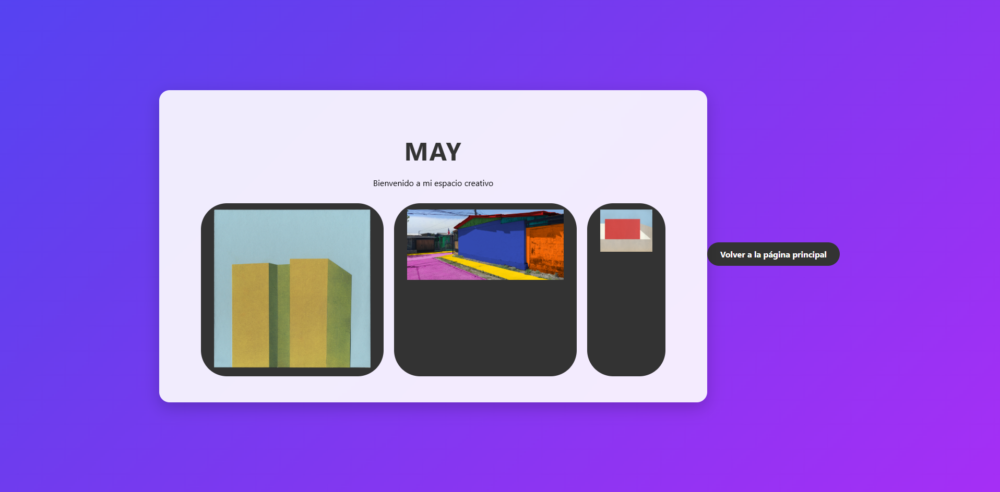
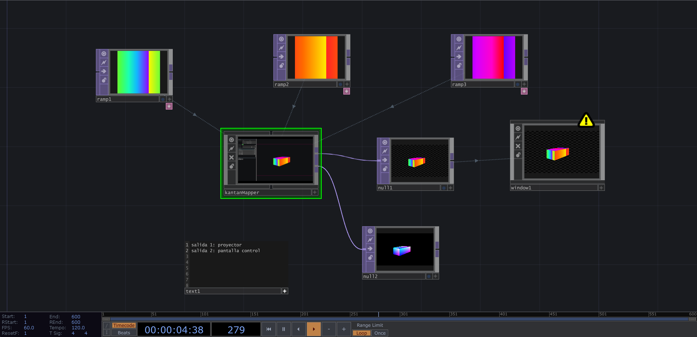
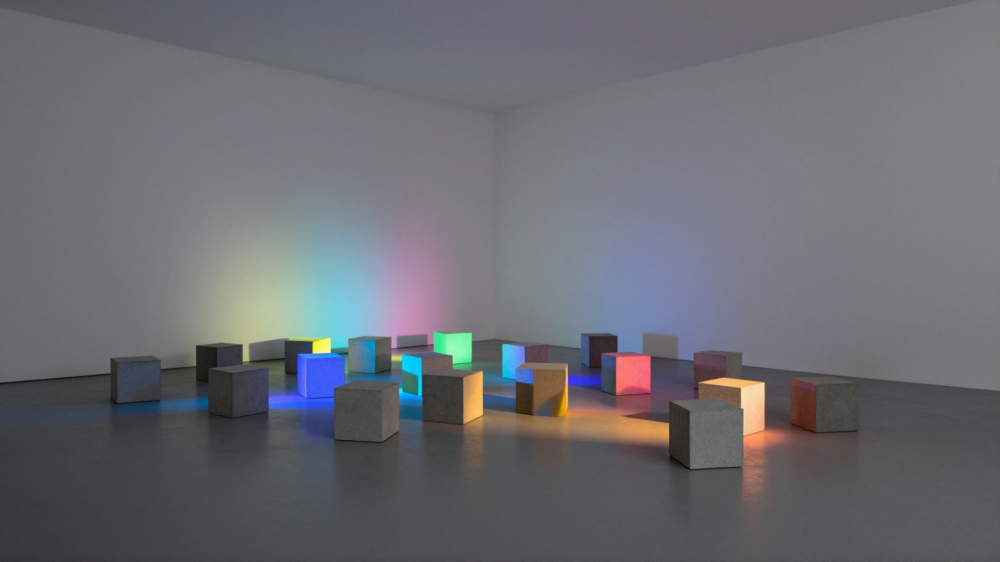
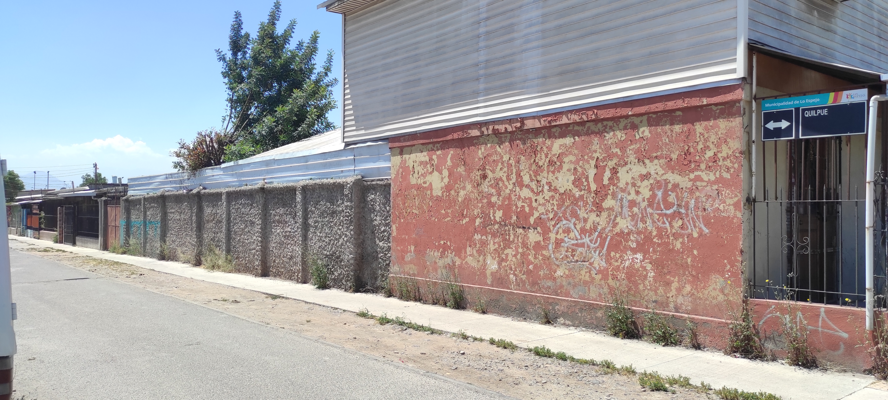
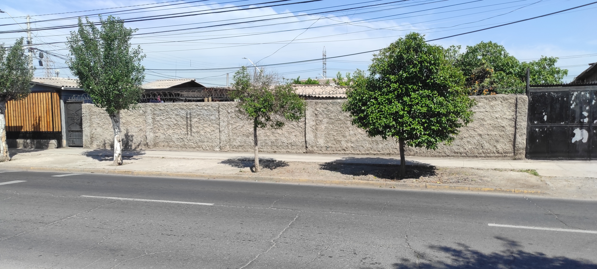
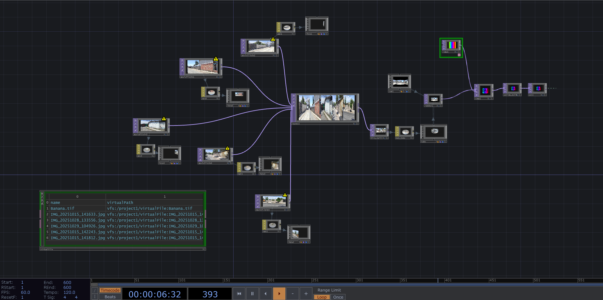
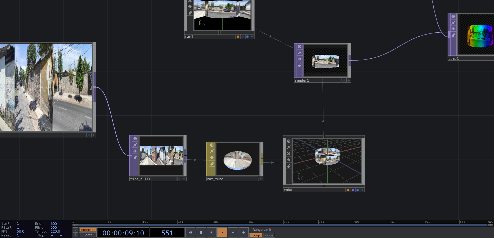

# MULTIMEDIAL


## Unidad I.
1. [Mi Primera página](#mi-primera-página) <br> 
2. [Mi sitio web / portafolio](https://maaaaay-beepbeep.github.io/multimedial-de-grado/w/index.html)

## Unidad II.
1. [Intro ToucDesigner](#1-introducción-touchdesigner) <br>
2. [Ejercicios](#2-ejercicios) <br>
3. [Comfy Desktop](#3-comfy-desktop) <br>
4. [Entrega final](#4-entrega-final) <br>

### Unidad I
#### Mi primera página
```html
<!DOCTYPE html>
<!-- Indica al navegador que este documento usa HTML5 -->

<html>
<!-- Inicio del documento HTML -->

<head>
<!-- Sección donde van metadatos, título y estilos -->

<meta charset="UTF-8">
<!-- Define la codificación de caracteres para que se vean bien tildes y símbolos -->

<title>Multimedial</title>
<!-- Título de la página que aparece en la pestaña del navegador -->

<style>
/* Aquí comienza la sección de estilos CSS que define la apariencia visual */

body{
/* "body" se refiere a todo el contenido visible de la página */

  background-color: white;
  /* Define que el fondo de toda la página sea blanco */

  color: black;
  /* Define que el color del texto sea negro */

  margin: 0;
  /* Elimina los márgenes que los navegadores agregan por defecto */

  height: 100vh;
  /* Hace que el alto del cuerpo sea igual al 100% de la altura de la pantalla */

  display: flex;
  /* Activa el sistema Flexbox para organizar y centrar elementos */

  justify-content: center;
  /* Centra el contenido horizontalmente */

  align-items: center;
  /* Centra el contenido verticalmente */

  font-family: Arial, sans-serif;
  /* Define la tipografía del texto */

  font-size: 60px;
  /* Define el tamaño grande del texto */

}
/* Fin de las reglas de estilo del body */

</style>
<!-- Fin de la sección de estilos -->

</head>
<!-- Fin de la sección head -->

<body>
<!-- Inicio del contenido visible de la página -->

MULTIMEDIAL
<!-- Texto que aparece en el centro de la pantalla -->

</body>
<!-- Fin del contenido visible -->

</html>
<!-- Fin del documento HTML -->
```

#### Página experimental / Portafolio





[ver portafolio](https://maaaaay-beepbeep.github.io/multimedial-de-grado/w/index.html) 

### Unidad II
#### 1. Introducción TouchDesigner

#### 2. Ejercicios

a. Point


b. Lsystem


c. Kantanmapper



#### 3. Comfy desktop

Prompt:
```text
Instalación artística abstracta. Gran abundancia de cubos pequeños de hormigón a ras de suelo, situados en una habitación espaciosa de paredes blancas, techo blanco y suelo opaco gris. En todos y cada unos de los cubos, en la cara superior, se observa la proyección con mapping de luz de color plano muy saturado; en cada cara superior es un color distinto. Unicamente, en la cara superior de los cubos se observa la luz de color, el resto de caras laterales del cubo mantienen su material base, es decir el hormigón. La paleta de colores es amplia y variada, solo colores planos. La proyección proviene de arriba hacia abajo, desde el techo hacia la cara superior de cada cubo que se encuentran dispuestos en el suelo de la habitación. Esta proyección de luces de colores se observa solo y únicamente en las caras superiores de cada cubo instalado en el suelo. La iluminación de la habitación es baja y oscura para que resalte la proyección en los cubos.
```

#### registros:


 




#### 4. Entrega final

imágenes originales:

 

 

 

 

 

proceso en TouchDesigner:

 

 

 


registro obra:


