<style>
@import url('https://fonts.googleapis.com/css2?family=Outfit:wght@400;600;800&display=swap');
/* Fondo animado de 10 colores (igual que mi portafolio) */
body {
  background: linear-gradient(135deg, #fc3232, #ff9719, #fff30e, #abf712, #31faaa, #2bdcfb, #1654ff, #693ded, #c427f9, #f830e7);
  background-size: 1000% 1000%;
  background-attachment: fixed;
  animation: gradient 30s ease-in-out infinite;
}
@keyframes gradient {
  0% { background-position: 0% 50%; }
  50% { background-position: 100% 50%; }
  100% { background-position: 0% 50%; }
}
/* Tarjeta blanca */
.markdown-body {
  background-color: rgba(255, 255, 255, 0.75);
  border-radius: 20px;
  box-shadow: 0 10px 30px rgba(0,0,0,0.2);
  padding: 40px !important;
}
/* Títulos */
.markdown-body h1, .markdown-body h2, .markdown-body h3, .markdown-body h4 { font-family: 'Outfit', sans-serif; }
.markdown-body > h1:first-child a { color: #333; text-decoration: none; pointer-events: none; }
.markdown-body h1 { font-size: 3.5rem; font-weight: 800; text-align: center; }
.markdown-body h2 { background-color: #333; color: white; padding: 12px 30px; border-radius: 50px; border-bottom: none; margin-top: 60px; }
.markdown-body h4 { display: inline-block; border: 2px solid #333; border-radius: 50px; padding: 4px 16px; text-transform: uppercase; }
/* Imágenes y código */
.markdown-body img { border-radius: 12px; }
.markdown-body pre, .markdown-body pre code { color: #1f2328 !important; }
/* Botón igual a los de mi portafolio */
.markdown-body a.boton { display: inline-block; text-decoration: none; color: white; background-color: #333; padding: 14px 32px; border-radius: 50px; font-weight: 600; transition: transform 0.3s; }
.markdown-body a.boton:hover { transform: translateY(-5px); background-color: #000; }
</style>

# bitácora

### Índice

**Unidad I**
1. [Mi Primera página](#mi-primera-página) <br> 
2. [Mi sitio web / portafolio](https://maaaaay-beepbeep.github.io/multimedial-de-grado/w/index.html)

**Unidad II**
1. [Intro TouchDesigner](#1-introducción-touchdesigner) <br>
2. [Comfy Desktop](#2-comfy-desktop) <br>
3. [Entrega final](#3-entrega-final) <br>

## UNIDAD I
### Mi primera página
```html
<!DOCTYPE html>
<!-- Indica al navegador que este documento usa HTML5 -->

<html>
<!-- Inicio del documento HTML -->

<head>
<!-- Sección donde van metadatos, título y estilos -->

<meta charset="UTF-8">
<!-- Define la codificación de caracteres para que se vean bien tildes y símbolos -->

<title>Multimedial</title>
<!-- Título de la página que aparece en la pestaña del navegador -->

<style>
/* Aquí comienza la sección de estilos CSS que define la apariencia visual */

body{
/* "body" se refiere a todo el contenido visible de la página */

  background-color: white;
  /* Define que el fondo de toda la página sea blanco */

  color: black;
  /* Define que el color del texto sea negro */

  margin: 0;
  /* Elimina los márgenes que los navegadores agregan por defecto */

  height: 100vh;
  /* Hace que el alto del cuerpo sea igual al 100% de la altura de la pantalla */

  display: flex;
  /* Activa el sistema Flexbox para organizar y centrar elementos */

  justify-content: center;
  /* Centra el contenido horizontalmente */

  align-items: center;
  /* Centra el contenido verticalmente */

  font-family: Arial, sans-serif;
  /* Define la tipografía del texto */

  font-size: 60px;
  /* Define el tamaño grande del texto */

}
/* Fin de las reglas de estilo del body */

</style>
<!-- Fin de la sección de estilos -->

</head>
<!-- Fin de la sección head -->

<body>
<!-- Inicio del contenido visible de la página -->

MULTIMEDIAL
<!-- Texto que aparece en el centro de la pantalla -->

</body>
<!-- Fin del contenido visible -->

</html>
<!-- Fin del documento HTML -->
```

### Mi sitio web / Portafolio

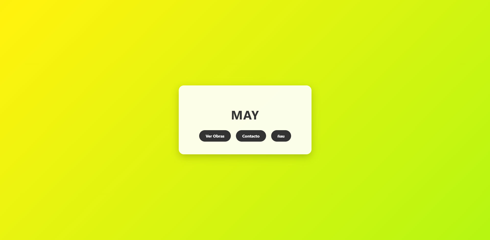


### CÓDIGO
```html
<!DOCTYPE html>
<html lang="es">
<head>
    <meta charset="UTF-8">
    <title>Bienvenida - May</title>
    <style>
        /* Fondo animado de 10 colores */
        body {
            font-family: 'Segoe UI', Arial, sans-serif;
            margin: 0;
            display: flex;
            justify-content: center;
            align-items: center;
            height: 100vh;
            overflow: hidden;
            background: linear-gradient(
                135deg, 
                #fc3232, #ff9719, #fff30e, #abf712, #31faaa, 
                #2bdcfb, #1654ff, #693ded, #c427f9, #f830e7
            );
            background-size: 1000% 1000%;
            animation: gradient 30s ease-in-out infinite;
        }

        @keyframes gradient {
            0% { background-position: 0% 50%; }
            50% { background-position: 100% 50%; }
            100% { background-position: 0% 50%; }
        }

        /* Tarjeta central de bienvenida */
        .bienvenida {
            text-align: center;
            background-color: rgba(255, 255, 255, 0.9);
            padding: 50px 80px;
            border-radius: 20px;
            box-shadow: 0 10px 30px rgba(0,0,0,0.2);
            backdrop-filter: blur(5px);
        }

        h1 {
            font-size: 3rem;
            color: #333;
            margin-bottom: 20px;
            letter-spacing: 2px;
        }

        .enlaces {
            display: flex;
            gap: 20px;
            justify-content: center;
            margin-top: 30px;
        }

        .enlaces a {
            text-decoration: none;
            color: white;
            background-color: #333;
            padding: 12px 25px;
            border-radius: 50px;
            font-weight: bold;
            transition: transform 0.3s, background-color 0.3s;
        }

        .enlaces a:hover {
            transform: translateY(-5px);
            background-color: #000;
        }
    </style>
</head>
<body>

    <div class="bienvenida">
        <h1>MAY</h1>
        <p></p>
        
        <div class="enlaces">
            <a href="indice.html">Ver Obras</a>
            <a href="contacto.html">Contacto</a>
            <a href="pagina3.html">ñau</a>
        </div>
    </div>

</body>
</html>
```
<a class="boton" href="https://maaaaay-beepbeep.github.io/multimedial-de-grado/w/index.html">Entra a mi portafolio </a>

## Unidad II
### 1. Introducción TouchDesigner

#### primer ejercicio: Point

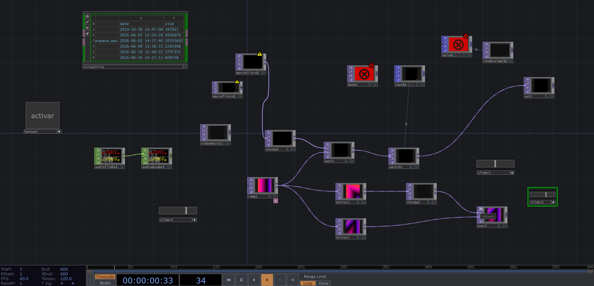

segundo ejercicio: Lsystem

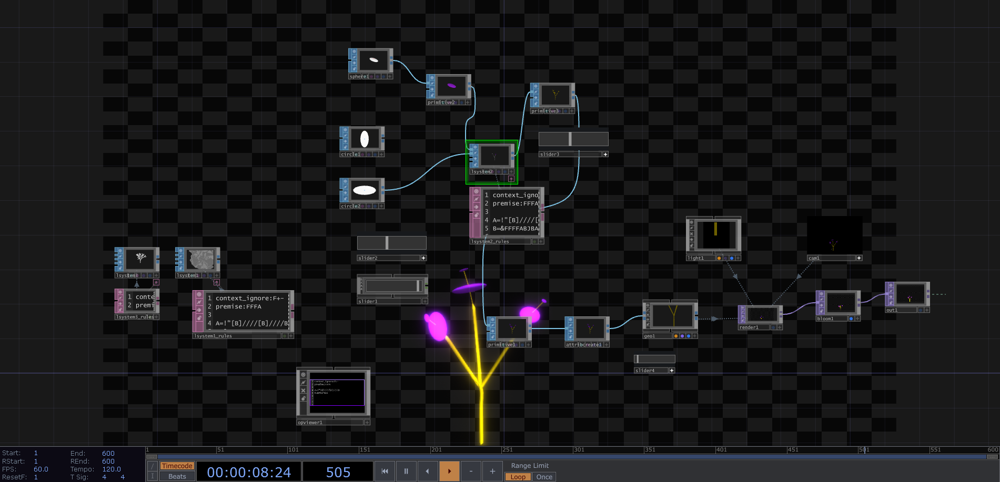

tercer ejercicio: Kantanmapper


### 2. Comfy desktop

Prompt:
```text
Instalación artística abstracta. Gran abundancia de cubos pequeños de hormigón a ras de suelo, situados en una habitación espaciosa de paredes blancas, techo blanco y suelo opaco gris. En todos y cada unos de los cubos, en la cara superior, se observa la proyección con mapping de luz de color plano muy saturado; en cada cara superior es un color distinto. Unicamente, en la cara superior de los cubos se observa la luz de color, el resto de caras laterales del cubo mantienen su material base, es decir el hormigón. La paleta de colores es amplia y variada, solo colores planos. La proyección proviene de arriba hacia abajo, desde el techo hacia la cara superior de cada cubo que se encuentran dispuestos en el suelo de la habitación. Esta proyección de luces de colores se observa solo y únicamente en las caras superiores de cada cubo instalado en el suelo. La iluminación de la habitación es baja y oscura para que resalte la proyección en los cubos.
```

#### registros:
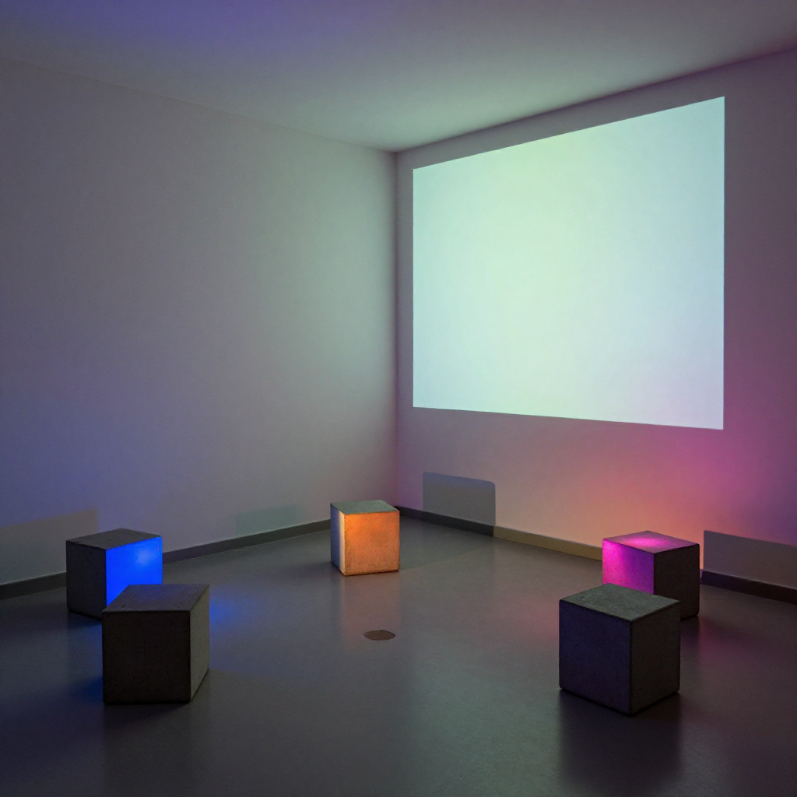

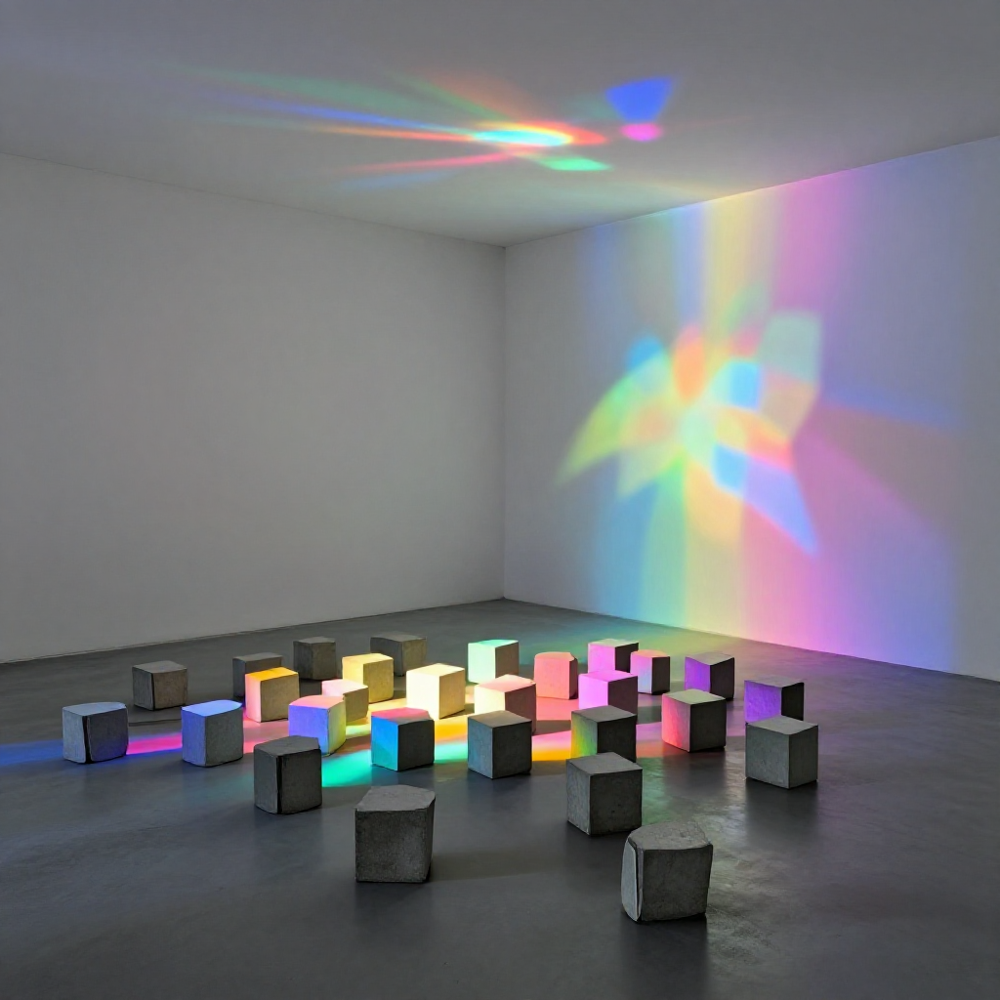

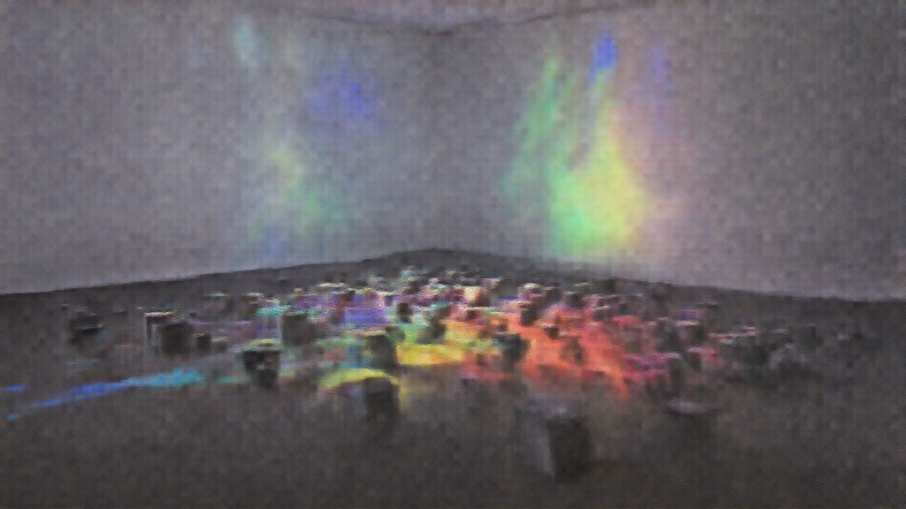 


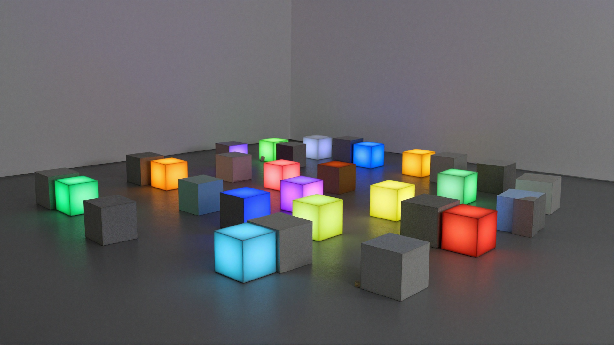

### 3. Entrega final

#### registro obra:

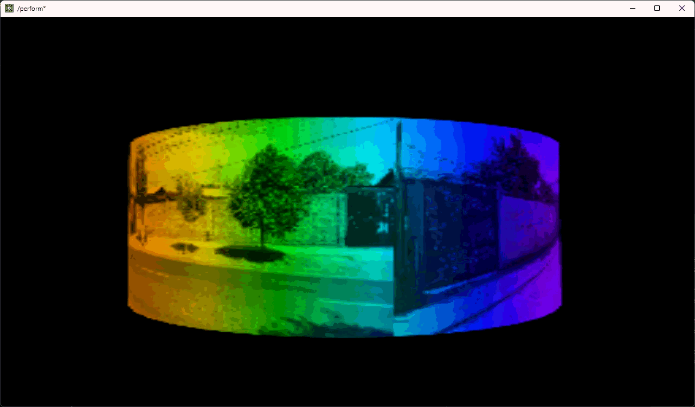

#### proceso en TouchDesigner:

 

 

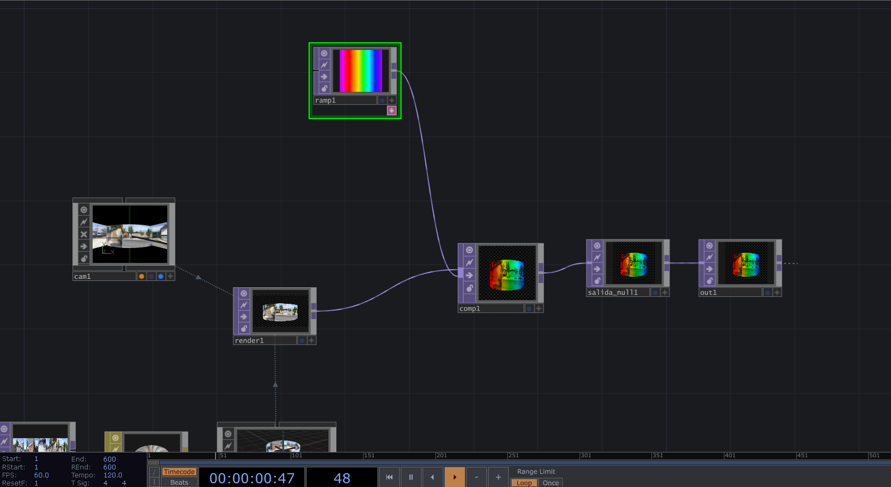 

#### imágenes originales:

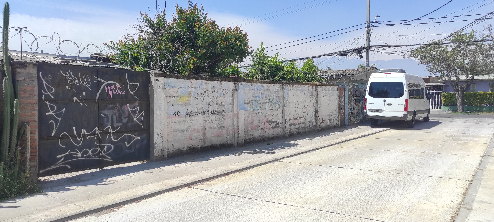 

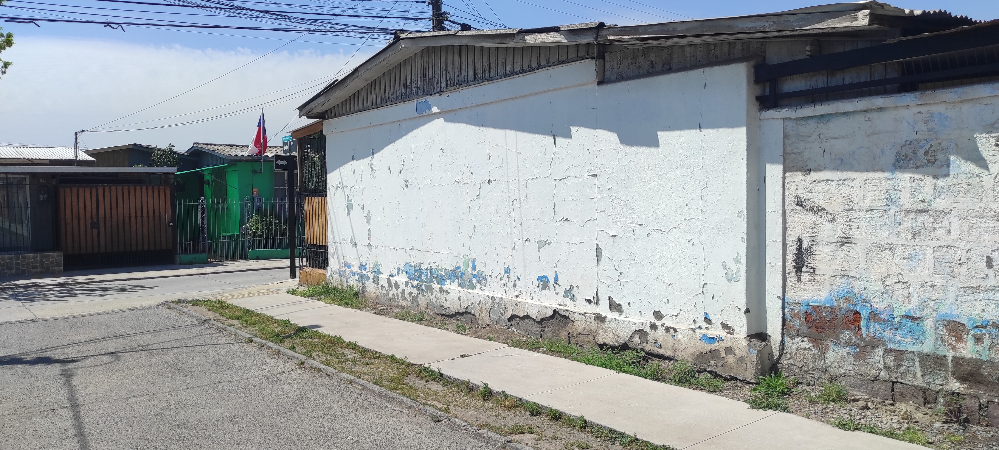 

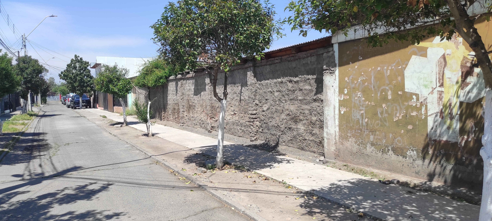 

 

 

#### Esta bitácora contiene uso de IA para ajustes de códigos y estética de la página.
